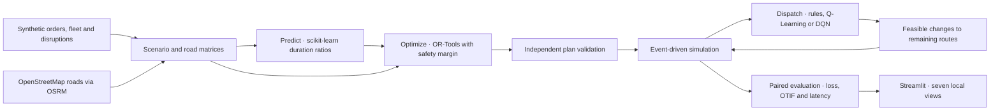
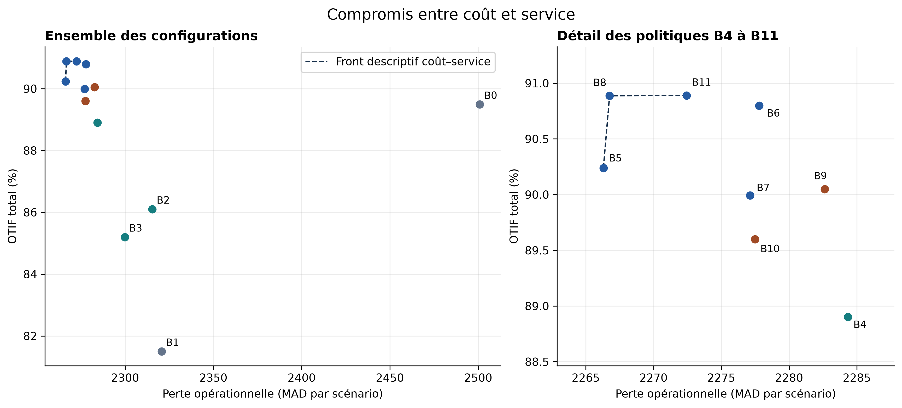
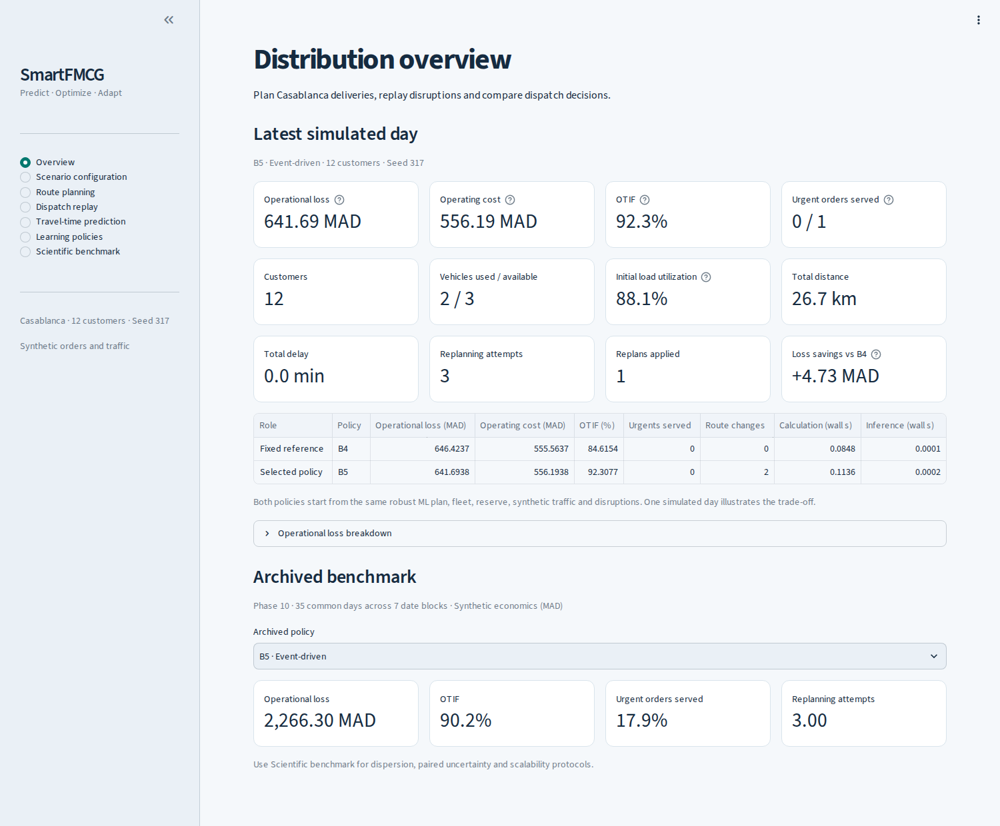
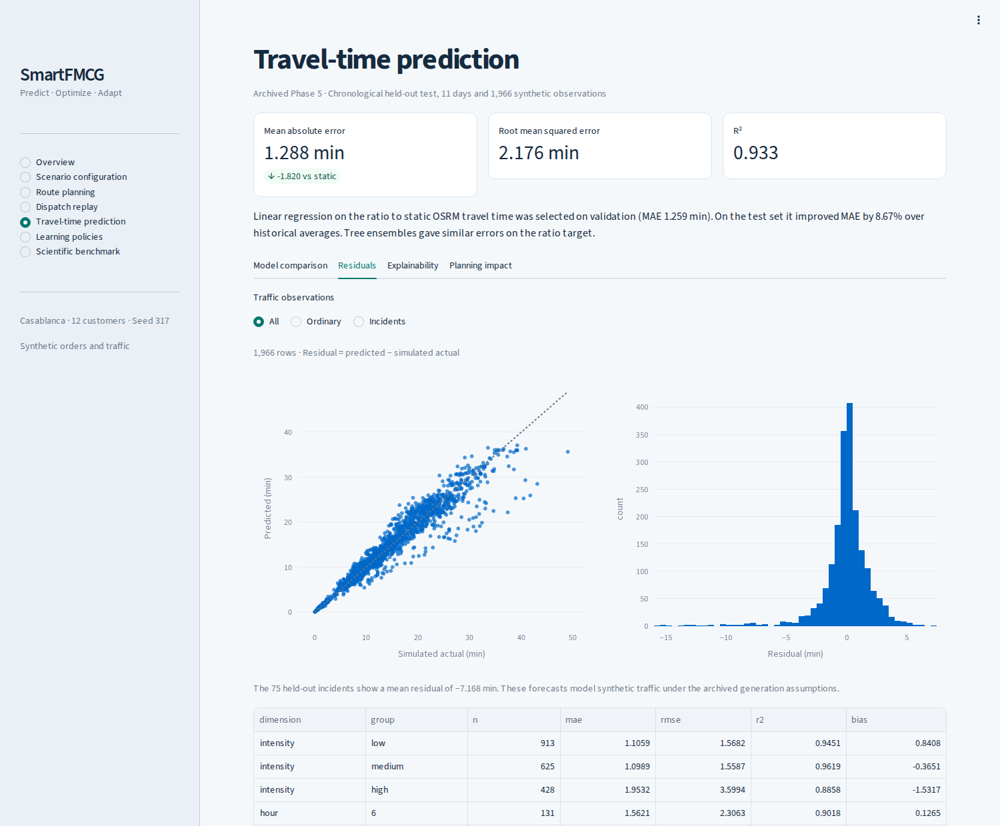

# SmartFMCG

SmartFMCG is a CPU-based decision-support project for beverage distribution in Casablanca. It predicts travel times, plans vehicle routes, and tests when to adapt those routes as congestion, service delays and urgent orders are revealed. The local Streamlit application connects the routing, simulation and benchmarking workflows.

## The distribution problem

A mixed fleet delivers beverages and collects empty packaging at the same stop. Vehicle loads evolve during each tour, so a route that fits at departure can overload after a pickup. The heterogeneous fleet vehicle routing problem with simultaneous pickup and delivery and time windows (HF-VRPSPD-TW) tracks four capacity dimensions, delivery inventory, returns, service times, vehicle access, cold-chain compatibility and mandatory versus optional orders. The planner minimizes modeled route costs and optional-order penalties subject to feasibility. An independent validator replays the plan. The simulator measures realized service and composite loss in Moroccan dirhams (MAD).

## Predict · Optimize · Adapt



- **Data engineering and geospatial analytics** generate seeded commercial instances, qualify directed road tables and visualize vehicle routes.
- **Machine learning and Predict-Then-Optimize** compare historical averages, linear and tree models under chronological splits. The selected linear model predicts a multiplier on OSRM duration. A past validation residual quantile supplies the planning margin.
- **Operations research and simulation** compare a greedy baseline with time-bounded OR-Tools routing. Event-driven replay tracks vehicle positions, remaining delivery inventory and existing commitments.
- **Tabular Q-Learning and deep reinforcement learning** choose among dispatch actions in a Gymnasium environment. NumPy and pandas support data processing, while Streamlit, Plotly and Folium provide the interactive views. Rule-based policies and frozen Stable-Baselines3/PyTorch CPU policies share the same feasibility checks and paired scenarios.

## Selected results

| Experiment | Archived result |
| --- | --- |
| Travel-time prediction | **1.288 min MAE** on 1,966 synthetic observations across 11 chronological test days. Historical average: 1.410 min. Static OSRM: 3.108 min. |
| Predictive safety margin | On 11 paired planning days, realized OTIF went from 89.39% with fixed ML to 94.85% with the margin. Static OSRM achieved 87.27%. In the separate 35-case benchmark, B4 gained 3.70 percentage points over unbuffered B3. |
| Adaptive versus fixed robust plan | B5, the event-driven rule, reduced mean composite loss by **18.05 MAD/day** and gained **1.34 percentage points of OTIF** versus B4 on 35 common cases in seven date blocks. Mean operating cost rose by 4.08 MAD/day. |
| Cost and service | B8 reached 90.89% OTIF versus 90.24% for B5. It averaged 10.29 replan attempts versus 3.00, with a +0.46 MAD/day mean loss difference whose paired interval spans zero. |
| Classical versus learned policies | B5 had lower mean loss than B9 (tabular Q-Learning) and B10 (continuous DQN) in the main benchmark. B10 improved upon fixed B4. At 100 customers, B9 had lower average loss than B5 across four cases, with mixed per-case differences. |
| Scalability | **100 customers and 16 available vehicles** end to end on the archived Casablanca OSRM road network. The 250-customer Haversine run covered planning and forecasting. The 500-customer run covered matrix construction and forecasting. |

OTIF is the share of orders delivered on time and in full. Composite loss includes modeled operations, omissions, delays, overtime and replanning. OpenStreetMap supplies real road geography. OSRM supplies static **estimates** of distance and travel time. Orders, fleet assumptions, traffic observations, disruptions and economic outcomes are synthetic or simulated. [Scientific evidence and figure index](docs/scientific_evidence.md) · [Data definitions](DATA_DICTIONARY.md)



*Archived cost–service frontier across the main synthetic benchmark.*

## Dashboard



*Distribution overview after a paired B4–B5 replay for the default 12-customer scenario.*



*Held-out synthetic travel-time observations, prediction errors and model metrics from the archived experiment.*

[Seven-view application gallery](docs/dashboard_gallery.md) · [Application guide](docs/dashboard.md)

## Run locally

The qualified platform is **CPython 3.14.2 on Linux x86-64** with PyTorch CPU. Use Python 3.14 and allow about 2 GiB for the application environment. The clean release candidate includes the frozen models and archived summaries. **Full scenario building, route planning, dispatch replay and detailed travel-time analysis require the seven-file authorized reference supplement.** The app can start on archived summaries before the supplement is installed. The required historical files must come from an authorized source. Put them in place before running the full integrity check. [Required artifact setup](docs/local_installation.md)

```bash
python3.14 -m venv .venv
source .venv/bin/activate
python -m pip install --only-binary=:all: pip==26.2
python -m pip install --only-binary=:all: -r dashboard/requirements.txt
python -m pip check
export OMP_NUM_THREADS=2 OPENBLAS_NUM_THREADS=2 MKL_NUM_THREADS=2 NUMEXPR_NUM_THREADS=2
python -m streamlit run dashboard/app.py
```

Open `http://localhost:8501`. After restoring and verifying the seven reference files, build the 12-customer scenario, generate a **Robust ML** plan and start a paired simulation with **B5 · Event-driven**. Select **Map without external tiles or scripts** in the route view for a network-independent map.

The app loads the frozen joblib predictor and the manifest-selected Q-Learning JSON and DQN ZIP files on CPU. Select B9, B10 or B12 in **Dispatch replay** to exercise frozen policy inference. Each uses the same robust reference plan. The artifact setup guide includes a command-line inference check. [Model loading and validation](docs/local_installation.md)

## Repository and reproducibility

| Path | Purpose |
| --- | --- |
| `src/`, `configs/` | Scientific modules and seeded experiment configurations |
| `dashboard/`, `.streamlit/` | Streamlit entry point, UI code and theme |
| `data/`, `models/` | Synthetic inputs, qualified geography and frozen predictor, subject to artifact availability |
| `notebooks/`, `results/experiments/` | Research notebooks, evaluation records, selected figures and policy artifacts |
| `tests/`, `docs/` | Regression and audit checks, user guide, scientific evidence and release notes |

With the appropriate artifacts restored, install the research requirements and run the dashboard notebook from the repository root. Outputs go to a separate file. [Notebook catalogue and full validation commands](docs/local_installation.md)

```bash
python -m pip install --only-binary=:all: -r requirements.txt -r dashboard/requirements.txt
python -m pytest -q tests/test_dashboard.py tests/test_release_remediation.py
python - <<'PY_NOTEBOOK'
import nbformat
from nbclient import NotebookClient
book = nbformat.read("notebooks/11_dashboard.ipynb", 4)
NotebookClient(book, timeout=60).execute()
nbformat.write(book, "/tmp/smartfmcg-dashboard.ipynb")
PY_NOTEBOOK
```

The full research snapshot passed **215 tests**. The restored release passed 74 focused checks covering the dashboard, artifact integrity, routing and traffic prediction. [Local testing](docs/local_installation.md)

## Limitations and future work

The experiments cover one city, synthetic operations, bounded solver searches and relatively few independent dates. The continuous DQN exceeded at least one archived training range on 94.8% of eligible decisions at 100 customers. The figures describe the evaluated scenarios. Future research could validate with independent observed traffic, sample more diverse road networks, and evaluate transfer and uncertainty across additional operating regimes.

## License and attribution

Original software is licensed under MIT. Eligible original documentation and scientific productions are licensed under CC BY 4.0. Road geography is credited to **© OpenStreetMap contributors** under ODbL 1.0, with historical route estimates generated by OSRM via FOSSGIS. [MIT license](LICENSE) · [Scope and attribution](DATA_LICENSE.md) · [Third-party notices](docs/third_party_notices.md)
