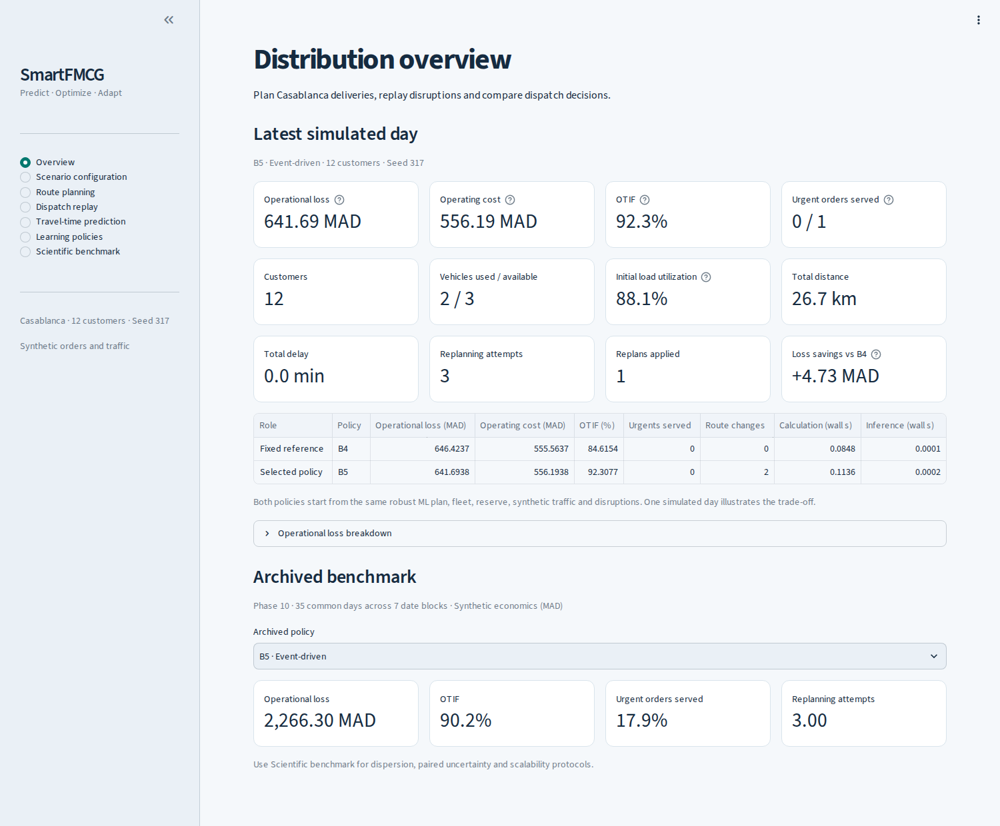
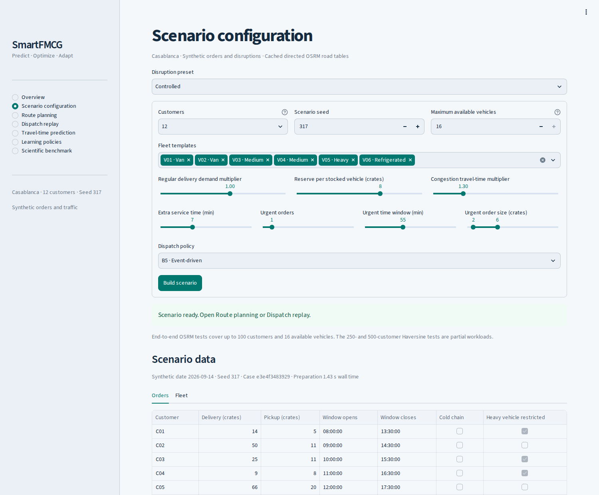
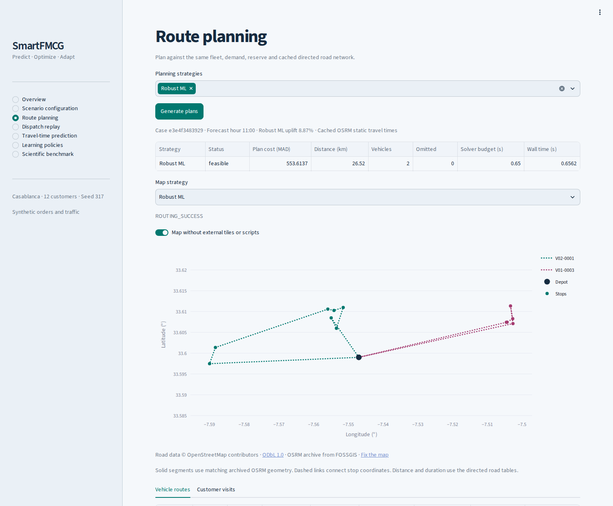
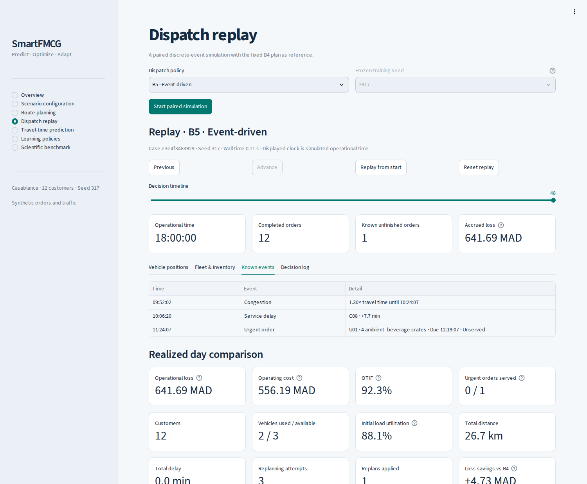
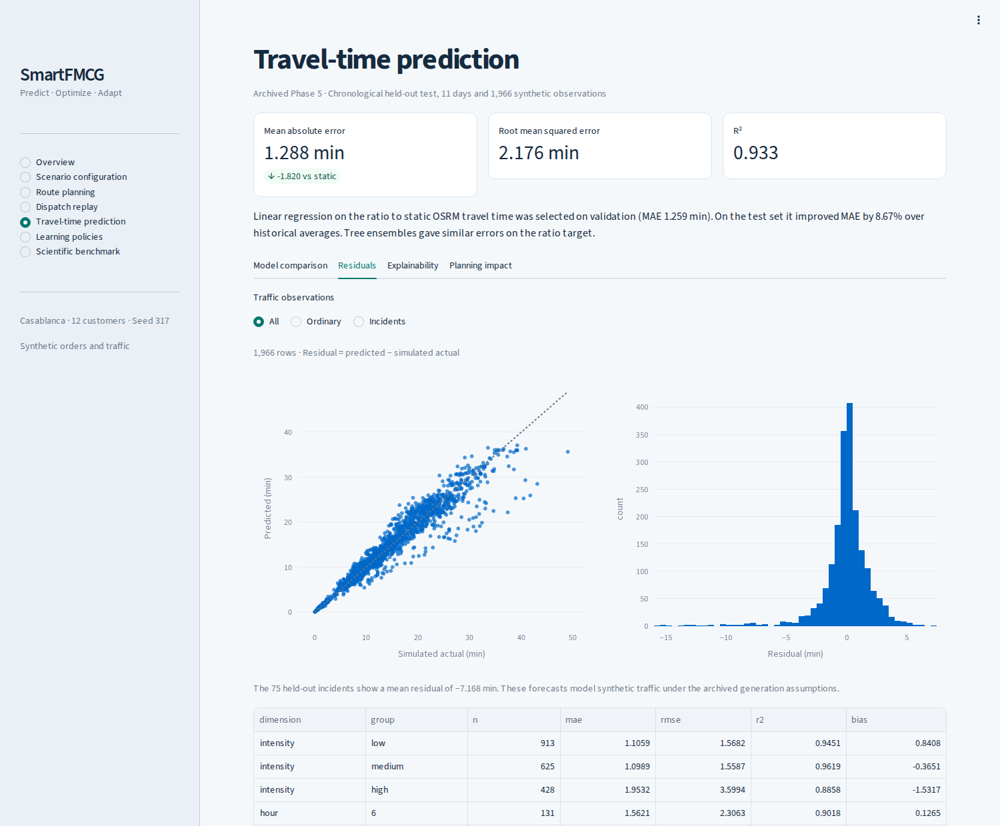
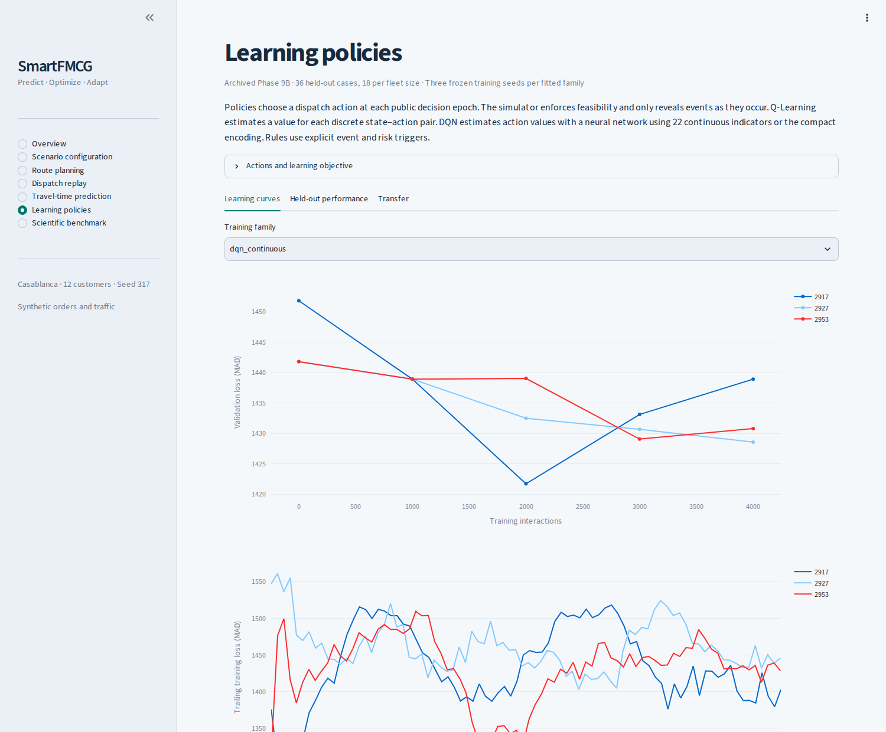
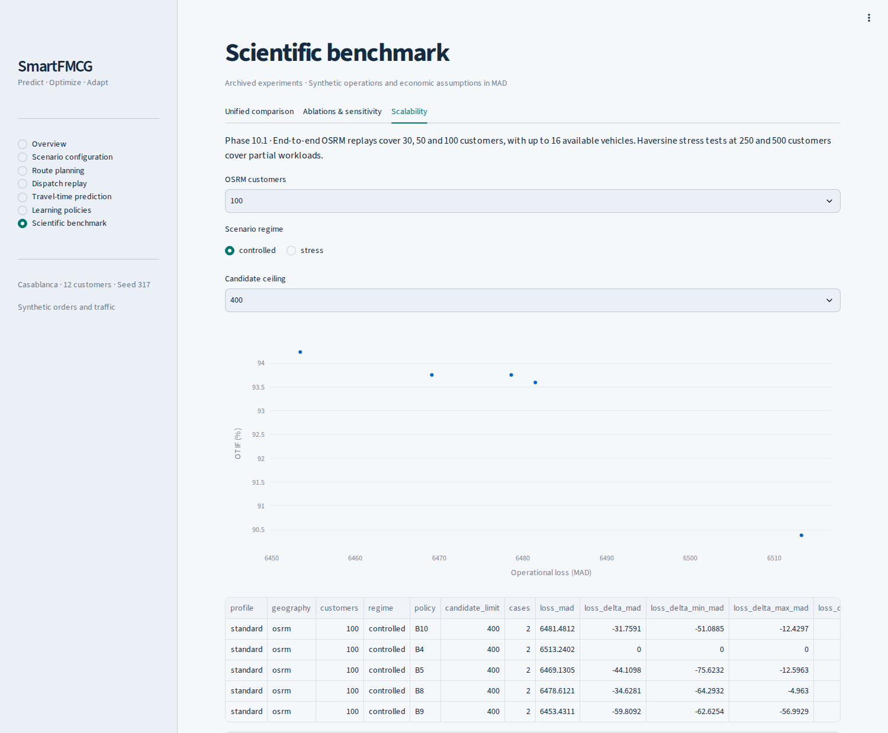

# SmartFMCG dashboard gallery

These Chromium captures come from the local Streamlit application. The operational views use the controlled synthetic scenario with 12 customers and seed 317. The analytical views use archived experiment results. External browser requests were blocked.

## Distribution overview

*Realized KPI cards after B5 and B4 replay the same day, followed by the archived benchmark summary.*

## Scenario configuration

*The scenario form sets fleet availability, demand, reserve, congestion, service delays and urgent orders. The app reports when the cached scenario is ready.*

## Route planning and GIS

*Two feasible vehicle routes under the Robust ML forecast. The map uses synthetic stop coordinates and schematic links without external tiles. The directed distance and baseline duration estimates use OSRM. Road data © OpenStreetMap contributors. [ODbL and attribution](https://www.openstreetmap.org/copyright)*

## Dynamic simulation

*The decision timeline and known-event log at the end of a paired replay, with realized service and cost.*

## Machine learning

*Chronological held-out prediction metrics, predicted versus simulated travel time and signed residuals.*

## Reinforcement learning

*Archived validation and training loss curves for three independently seeded continuous DQN fits.*

## Scientific benchmark and scalability

*Archived cost–service trade-offs at 100 customers in the controlled regime, with the 400-candidate setting.*
