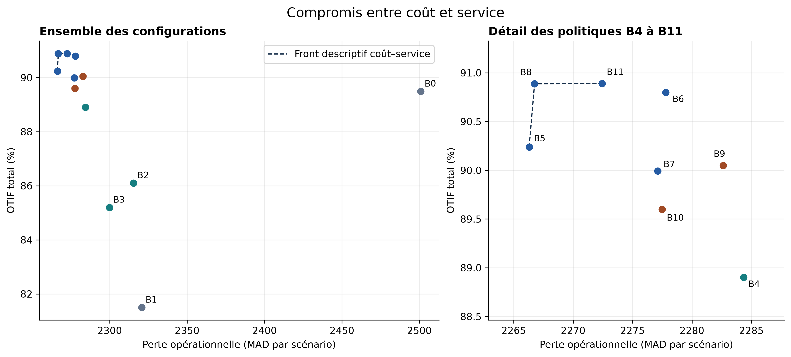

# Scientific evidence

The underlying road geography comes from OpenStreetMap. OSRM provides static route estimates. Demand, traffic observations, disruption schedules and economic outcomes are simulated. The figure index points to archived results and captures from the running application.

| Topic | Evidence and interpretation |
| --- | --- |
| End-to-end architecture | The Predict · Optimize · Adapt diagram in the [README](../README.md) follows the separation between the planned route, chronological replay and policy decisions. |
| Travel-time prediction | The [prediction view](screenshots/travel_time_prediction.png) shows 1.288 min MAE, 2.176 min RMSE and the held-out residuals. Incidents were underpredicted by an average of 7.168 min across 75 observations. [Prediction report](traffic_prediction.md). |
| Predictive margins | The 80th validation percentile of signed ratio residuals adds about 53 seconds to a 10-minute OSRM leg. On 11 paired days it increased realized OTIF to 94.85%. The interval in the later benchmark describes variation across date blocks. [Planning report](predict_then_optimize.md) · [Accuracy and operations](../results/experiments/final_benchmark/figures/08_accuracy_and_operations.pdf) · [Component ablation](../results/experiments/final_benchmark/figures/03_component_ablation.pdf). |
| Operational benchmark and cost–OTIF | B5 and B8 show a trade-off between service and attempts on 35 common cases over seven date blocks. B5 reduces composite loss relative to B4 even as its operating cost increases. [Benchmark report](final_benchmark.md) · [End-to-end comparison](../results/experiments/final_benchmark/figures/01_end_to_end.pdf) · [Cost–service frontier](../results/experiments/final_benchmark/figures/02_cost_service_pareto.pdf). |
| Reinforcement learning | Seed and scenario sensitivity motivate comparison with frozen rule-based policies. The [learning curves](screenshots/learning_policies.png) display the continuous DQN validation histories from all three selected training seeds. [Evaluation report](dqn_evaluation.md) · [Between-seed comparisons](../results/experiments/final_benchmark/figures/06_learned_seed_variability.pdf). |
| Scalability | All 138 final OSRM replays across 30, 50 and 100 customers delivered the mandatory orders and passed physical journal validation. The 100-customer envelope uses at most 16 available vehicles. The 250- and 500-customer Haversine workloads are partial. [Scalability report](scalability.md) · [Planning time](../results/experiments/scalability/figures/01_initial_routing.pdf) · [Prediction and matrix scaling](../results/experiments/scalability/figures/04_prediction_and_matrices.pdf) · [Policy transfer](../results/experiments/scalability/figures/08_policy_transfer.pdf). |

*The archived Phase 10 cost–service frontier summarizes simulated outcomes in MAD and OTIF. Marker positions describe this scenario bank.*

The scientific reports describe the archived experiments. See the [local guide](local_installation.md) for the reproducible demonstration.
